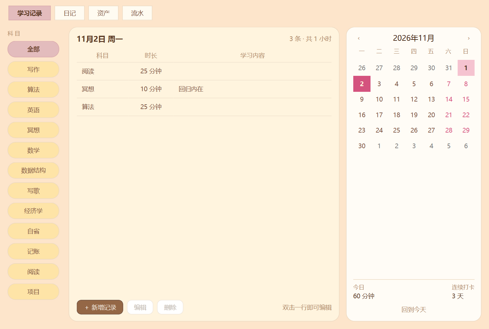
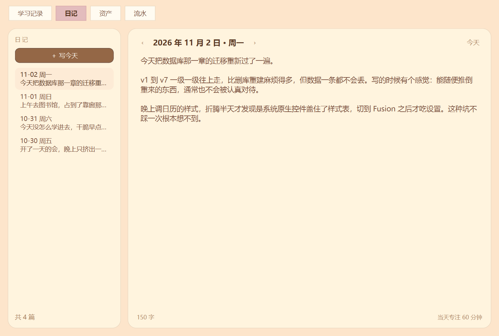
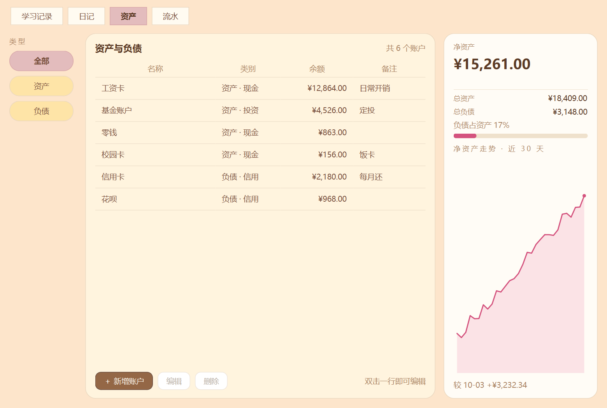
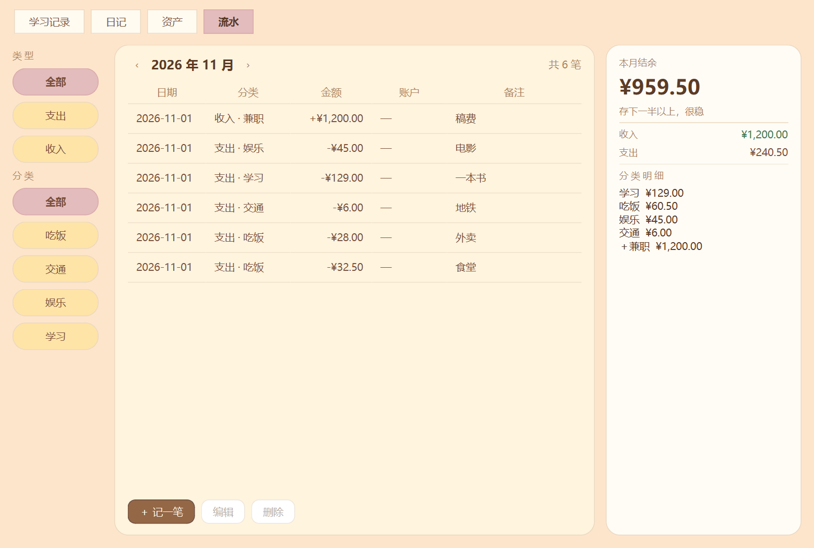

# CatStudy

一只浮在桌面上的像素橘白猫。你专注时它原地走动，你休息时它安静坐着；你学过的每一段专注，都会变成日历上的标记、一天一篇的日记，和一本自己的账。

Windows 桌面应用 · Python + PySide6 + SQLite · 完全离线，不含任何网络请求

| 学习记录 | 日记 |
|:---:|:---:|
|  |  |

| 资产与负债 | 收支流水 |
|:---:|:---:|
|  |  |

> 截图由 `tools/capture_screenshots.py` 生成。脚本先把数据库副本上的账户、金额、流水、日记全部替换成演示数据再截图，原始数据不会被带进仓库。

---

## 为什么做这个

市面上有太多"专注 App"，绝大多数在用同一种方式留人：打卡、连续天数、排行榜、中断就清零。它们把学习变成一场考核，而考核会让人在忙的那个星期直接卸载。

CatStudy 选的是另一条路：**猫不向你索取任何东西。**

它不会饿、不会生病、不会因为你三天没学习就变丑。它只是在你专心的时候，在你身边走来走去。你打开它是因为你想学习，不是为了喂它。

这个取舍贯穿了整个项目，代码里能看到具体落点（见[设计取舍](#设计取舍)）。

## 功能

**专注**
- 番茄钟（25 分钟）与正计时，可暂停 / 继续 / 结束 / 放弃
- **一键暂停**：鼠标单击猫身，或按 `Ctrl+Alt+Space`（全局生效，任何窗口里都能按）；猫会跟着停下来坐着
- 小猫下方浮动读数气泡，悬停可见剩余时间
- **全屏计时牌**：铺满整个桌面的大号倒计时，三米外可读；Esc 或点击收起，计时不中断
- **完成礼花**：满 1 分钟的专注结束时全屏炸开像素礼花并送上一句祝贺——点击穿透、不抢焦点、不问"再来一个？"，几秒后自己消散
- 结束自动写入当天学习记录，不需要二次确认

**桌宠**
- 无边框、透明、置顶，可拖动，单击暂停/继续，双击开面板，右键菜单
- 专注时原地走 8 帧循环（120ms/帧），休息与暂停时完全静止
- 开机自启动（写 `HKCU\...\Run`，开关状态真实可读）

**学习记录**
- 笔记本风格窗口，奶油配色日历，按科目筛选
- 当天列表、增删改、今日合计、连续打卡天数

**日记**
- 一天一篇，左栏时间线回看，右侧无边框编辑器
- 停止打字 1.2 秒自动保存；清空正文即删除当天日记
- 底部显示字数与当天专注时长

**专注统计**
- 独立页签：今天 / 本周 / 本月 / 今年 / 全部五个区间，一键切换
- 环形图给结构，图例给数字（时长 + 占比），中心是合计时长
- 科目超过 8 个自动把尾部合并为"其他"；占比按时长计算，不按次数
- 只显示结构，不设目标、不标红任何"过低占比"

**资产与流水**
- 账户清单区分资产/负债，展示总资产、总负债、净资产、负债比例
- 近 30 天净资产走势折线
- 收入与支出同表管理，分类筛选
- **流水可选择是否联动账户余额**（四种组合由纯函数表达）
- 金额支持算式：输入 `6.9+2.49` 直接得 9.39
- 当月结余、分类明细、结余率提示语

## 快速开始

需要 Python 3.12+（开发环境为 3.14.4）。

```bash
git clone https://github.com/12star12/CatStudy.git
cd CatStudy
python -m venv .venv
.venv\Scripts\activate          # macOS/Linux: source .venv/bin/activate
pip install -r requirements.txt
python main.py
```

首次启动会在 `data/catstudy.db` 自动建库并迁移到最新 schema，**不需要手动初始化**。

## 架构

```
ui/        表现层   PySide6 窗口、控件、像素动画、主题
core/      领域层   仓储、状态机、纯函数、schema 迁移
SQLite     数据层   6 张表，schema v7
```

三条硬纪律：

1. **UI 层零 SQL。** `ui/` 下不存在任何 `import sqlite3` 或 `execute(`，全部读写经 `core/` 的仓储类。界面可替换、可测试。
2. **业务规则不写在界面里。** "记一笔流水要不要改余额"这四组合，收敛成一个纯函数，不在 UI 里写 if-else。
3. **迁移逐级进行。** v1→v7 每一级是独立函数，不是"删库重建"。真实数据零丢失。

| 模块 | 职责 |
|---|---|
| `core/timer.py` | 专注状态机，用单调时钟差值算时长 |
| `core/database.py` | 连接管理、版本读取、逐级迁移 |
| `core/study_records.py` | 学习记录仓储 |
| `core/accounts.py` | 账户、净资产合计、每日快照 |
| `core/expenses.py` | 收支流水、余额联动、月度统计 |
| `core/journal.py` | 日记读写，空内容即删行 |
| `core/autostart.py` | 注册表自启动 |
| `ui/sprite.py` | 像素矩阵 → QPixmap，帧角色解析 |
| `ui/focus_overlay.py` | 全屏计时牌，按屏幕并集布局 |
| `ui/theme.py` | 主题与 QSS，包含日历控件的原生样式绕过 |

## 设计取舍

这些是有意识的决定，不是偷懒。

**不做养成，做陪伴。**
没有饥饿值、没有惩罚、没有经验条、没有满级。原因：惩罚机制会让用户在忙的那一周永久流失，而"忙"恰恰是最需要这个工具的时候；经验条会把学习变成刷数值，动机从"我想弄懂"滑向"我要升级"。

**猫的状态只由专注时长驱动，零额外操作。**
不需要喂食、洗澡、点击互动。成长是专注的副产品，不是一项任务。

**金额一律用整数"分"存储。**
不使用浮点，避免 `0.1+0.2` 类误差在记账场景里累积。

**算式求值走 `ast` 白名单，禁用 `eval`。**
用户能在输入框里算 `6.9+2.49`，但这意味着要执行用户输入的字符串。只放行数字、四则运算与括号，其余 AST 节点一律拒绝。

**流水联动做成纯函数。**

```python
flow_delta(flow_kind, account_kind, amount) -> int
```

四种组合（收入/支出 × 资产/负债）各自对余额的影响由一个纯函数给出，UI 只负责取结果。加新组合时只改这一处。

**先 `setStyle("Fusion")` 再上 QSS。**
Windows 原生样式会无视部分 QSS 规则（日历的星期行尤其明显），必须先把基样式切到 Fusion。这一步漏掉的后果是"主题看起来生效了，但有些控件永远是系统灰"。

**没有服务端，也不打算有。**
断网时计时、动画、全屏计时牌都必须能用。加后端会引入登录、同步冲突、部署运维，而它换来的只是一个自己能写的简历标签。

## 开发文档

[`docs/DEVELOPMENT.md`](docs/DEVELOPMENT.md) —— **约 1600 行，16 章重建级规格书。**

目标是可以只读这份文档 + 仓库里的素材，把这套程序从零手搓一遍。包含：

- 分层纪律与各层职责边界
- 从零重建的实现顺序（每章末尾有验收清单）
- 全部常量、字段名、方法签名的真实取值
- **59 条陷阱清单**——已经踩过的坑，包括为什么错、错了会怎样、正确做法是什么
- 素材管线的用法（GIF → 像素矩阵）

## 测试

521 个测试，覆盖数据层、迁移、仓储、状态机、界面接线、动画、礼花运动学、统计区间与格式化。

```bash
# Windows
set QT_QPA_PLATFORM=offscreen
python -m unittest discover -s tests

# macOS / Linux
QT_QPA_PLATFORM=offscreen python -m unittest discover -s tests
```

迁移测试会在临时目录里造一份旧版本数据库，逐级升上来再校验数据，因此需要先关连接再删目录（`addCleanup` 的后进先出）。

## 路线图

- [ ] 日记全文搜索
- [ ] 数据导出 / 备份（CSV 与整库快照）
- [ ] 专注结束提示音
- [ ] 成长感：场景随时间缓慢变化（连续显影，不设等级与阈值）

## 素材

`assets/cat/` 下的像素帧由 GIF 经 `tools/extract_walk_frames.py` 提取为字符矩阵（`CELL=10`，透明度阈值 0.2），运行时直接渲染，不依赖图片加载。

## License

[MIT](LICENSE)
